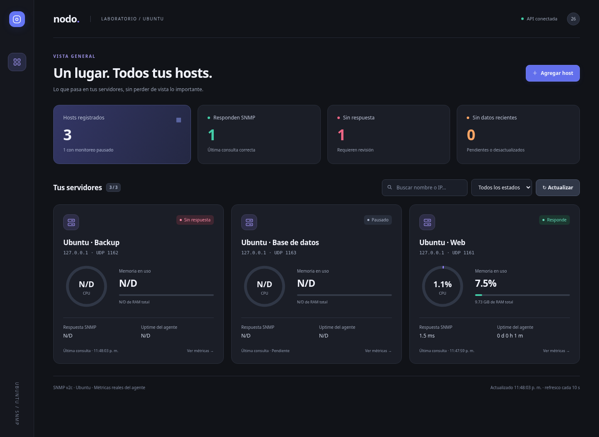
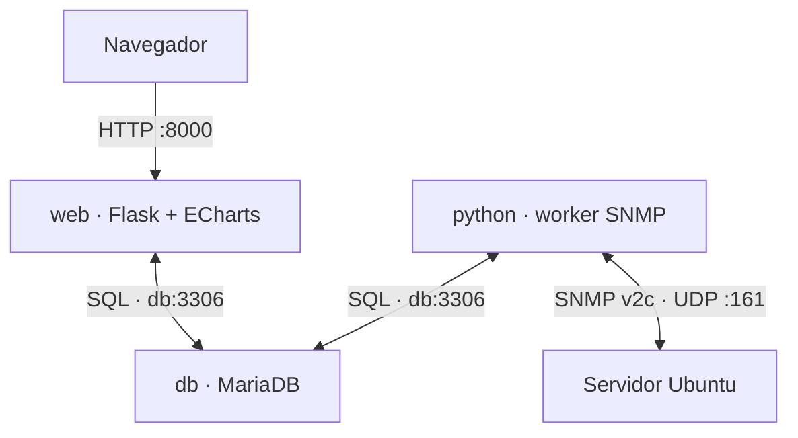

# Nodo · Proyecto Docker 2026

Monitor **SNMP v2c para servidores Ubuntu**, desarrollado para una presentación de Linux y virtualización. Tres contenedores, dos Dockerfiles sencillos y un único `docker-compose.yml`.

## Qué hace

- Dashboard oscuro con una tarjeta por servidor, búsqueda y filtro por estado.
- Vista ampliada al hacer clic: gráficos **Apache ECharts** de CPU, memoria y tiempo de respuesta, información del sistema e historial de consultas.
- Alta, modificación, pausa y eliminación de hosts mediante formularios HTML nativos.
- Configuración de nombre, IPv4, puerto UDP y community de lectura por host.
- Recolección real de métricas, sin datos simulados ni hosts precargados.
- Persistencia en `DB/data/`; historial de siete días y visualización de las últimas 120 muestras de la configuración actual.

El alcance es académico: pocos servidores Ubuntu con Net-SNMP. No implementa SNMPv3, descubrimiento de red, traps ni MIB de fabricantes.

## Vista previa



Captura de las pruebas con un agente local, un destino sin respuesta y un host pausado. Esos hosts no vienen precargados en la aplicación.

## Los tres servicios



| Servicio | Responsabilidad | Archivos principales |
|---|---|---|
| `db` | Guardar hosts y muestras; conservar los datos | `DB/init.sql`, `DB/data/` |
| `python` | Leer hosts, consultar SNMP y guardar muestras | `Python/worker.py`, `requirements.txt`, `Dockerfile` |
| `web` | Servir la interfaz y la API de administración | `Web/api.py`, `index.html`, `requirements.txt`, `Dockerfile` |

`Web/index.html` contiene HTML, CSS y JavaScript propios. `Web/echarts.min.js` es la distribución oficial de Apache ECharts 6.0.0, con sus archivos de licencia y avisos. Se sirve localmente: **el dashboard no depende de una CDN ni de Internet**. No se necesita Node.js para levantar el proyecto.

## Puesta en marcha

Requisitos: Git, Docker Engine o Docker Desktop con **Docker Compose v2**, y conectividad hacia un Ubuntu con SNMP habilitado. La primera construcción necesita Internet para descargar las imágenes y dependencias.

```bash
# Descargar el proyecto y entrar en su directorio.
git clone https://github.com/GonBlank/proyecto_docker_2026.git
cd proyecto_docker_2026

# Crear la configuración local. Este archivo está excluido de Git.
cp .env.example .env
```

Editar `.env` y reemplazar **ambas contraseñas de ejemplo**. Para exponer la interfaz desde una VM a otras máquinas del laboratorio, cambiar `WEB_BIND_IP=0.0.0.0`; para usarla sólo en el host, conservar `127.0.0.1`.

```bash
# Construir Web y Python, descargar MariaDB e iniciar los tres servicios.
docker compose up -d --build

# Revisar el estado: db debe aparecer como healthy.
docker compose ps

# Seguir el registro del recolector; Ctrl+C deja de ver logs, no lo detiene.
docker compose logs -f python
```

Abrir **http://localhost:8000**. Desde otra PC, si se habilitó la escucha de red: `http://IP_DE_LA_VM:8000`.

En **Agregar host**, completar la IP real del Ubuntu, el puerto —normalmente `161`— y la community configurada en ese servidor. Esperar la siguiente ronda del worker.

**No usar `127.0.0.1` como IP del Ubuntu monitoreado:** desde el worker esa dirección apunta al propio contenedor. La IP debe ser alcanzable desde la VM o máquina donde corre Docker.

### Variables disponibles

| Variable | Valor inicial | Uso |
|---|---|---|
| `DB_NAME` | `monitor` | Base de datos de la aplicación |
| `DB_USER` | `monitor` | Usuario SQL de Web y Python |
| `DB_PASSWORD` | Reemplazar | Contraseña del usuario de aplicación |
| `DB_ROOT_PASSWORD` | Reemplazar | Contraseña del administrador de MariaDB |
| `WEB_BIND_IP` | `127.0.0.1` | Interfaz del host en la que se publica la web |
| `WEB_PORT` | `8000` | Puerto HTTP publicado |
| `POLL_INTERVAL` | `30` | Segundos de pausa entre rondas, mínimo 5 |
| `RETENTION_DAYS` | `7` | Días de historial conservados, mínimo 1 |

Los hosts se consultan secuencialmente. El tiempo de una ronda es la suma de las consultas más `POLL_INTERVAL`; no es un muestreo exacto cada 30 segundos. La web vuelve a leer la API cada 10 segundos sin recargar la página.

## Preparar el Ubuntu monitoreado

Instalar el agente y las herramientas de comprobación:

```bash
# Ejecutar en el servidor Ubuntu que se va a monitorear.
sudo apt update
sudo apt install -y snmpd snmp

# Guardar la configuración original antes de editarla.
sudo cp /etc/snmp/snmpd.conf /etc/snmp/snmpd.conf.bak
sudo nano /etc/snmp/snmpd.conf
```

Para un laboratorio, reemplazar el contenido por esta configuración mínima. Sustituir `192.168.1.10` por la **IP de origen que verá Ubuntu al recibir las consultas** y `mi_community_lab` por la community elegida:

```conf
# Escuchar consultas SNMP por UDP/161 en las interfaces IPv4.
agentAddress udp:161

# Lectura del árbol SNMP desde el origen autorizado.
# En una VM Docker y un Ubuntu remoto, normalmente es la IP de la VM Docker.
rocommunity mi_community_lab 192.168.1.10/32 .1

sysLocation Laboratorio Linux
sysContact Administrador
```

No dejar una línea anterior de `rocommunity` con una vista `systemonly` para la misma community: podría limitar las consultas a los datos de sistema y ocultar CPU o RAM.

```bash
# Aplicar la configuración y habilitar el inicio automático del agente.
sudo systemctl enable snmpd
sudo systemctl restart snmpd
sudo systemctl status snmpd --no-pager

# Sólo si UFW está activo: permitir consultas desde el host de Docker.
sudo ufw allow from 192.168.1.10 to any port 161 proto udp
```

Verificar desde una máquina autorizada con el paquete `snmp` instalado:

```bash
# Sustituir 192.168.1.20 por la IP del Ubuntu monitoreado.
# Consulta sysName.0 y sysUpTime.0 usando OID numéricos.
snmpget -v2c -c mi_community_lab 192.168.1.20 \
  1.3.6.1.2.1.1.5.0 1.3.6.1.2.1.1.3.0

# Recorrer la carga de los procesadores.
snmpwalk -v2c -c mi_community_lab 192.168.1.20 \
  1.3.6.1.2.1.25.3.3.1.2
```

SNMPv2c transmite la community sin cifrado. Usar una community de **sólo lectura**, restringida al laboratorio. La aplicación tampoco incorpora autenticación: su publicación predeterminada es local; exponerla sólo en la red de la demostración.

## Métricas recolectadas

| Métrica | Origen | Interpretación |
|---|---|---|
| Estado | Consulta de los OID de sistema | Si la consulta SNMP responde correctamente |
| Tiempo de respuesta | Duración del GET inicial | Milisegundos de la operación SNMP, no ping ICMP |
| Nombre y descripción | `sysName.0`, `sysDescr.0` | Identificación que entrega el agente |
| Uptime del agente | `1.3.6.1.2.1.1.3.0` | Tiempo desde que arrancó el agente SNMP; no necesariamente Ubuntu |
| CPU | `1.3.6.1.2.1.25.3.3.1.2` | Promedio de `hrProcessorLoad` de los procesadores; carga del último minuto |
| RAM total | `1.3.6.1.4.1.2021.4.5.0` | Memoria física informada por Net-SNMP |
| RAM utilizada | OID `.4.5.0`, `.4.6.0`, `.4.14.0`, `.4.15.0` del árbol `1.3.6.1.4.1.2021` | `(total − libre − buffers − caché) / total × 100` |

El uso de RAM es una estimación de Net-SNMP, no una reproducción exacta de `free`/`MemAvailable`. Si falta un OID opcional, se muestra **N/D**; no se inventan valores ni se declara una caída por faltar una métrica.

Después de iniciar o reiniciar `snmpd`, algunas versiones de Net-SNMP tardan aproximadamente un minuto en publicar CPU. Durante ese tiempo puede aparecer N/D aunque el host responda y la RAM ya esté disponible ([reporte en Net-SNMP](https://github.com/net-snmp/net-snmp/issues/896)).

### Estados del host

| Estado | Significado |
|---|---|
| Responde | La última consulta SNMP fue correcta |
| Sin respuesta | No se obtuvo una respuesta válida; revisar red, puerto, community y vista SNMP |
| Pendiente | Todavía no hay muestras de la configuración actual |
| Desactualizado | La última muestra supera `max(90 s, 3 × POLL_INTERVAL)`; revisar el worker |
| Pausado | No se realizan nuevas consultas |

“Sin respuesta” no demuestra que Ubuntu esté apagado. El historial muestra **una barra por consulta**, no disponibilidad porcentual ni un intervalo continuo garantizado.

Editar un host inicia una nueva versión de configuración: las muestras anteriores se conservan hasta vencer la retención, pero la interfaz muestra las de la versión actual. Eliminarlo borra sus muestras mediante `ON DELETE CASCADE`.

## Qué explicar sobre Docker

1. **Imágenes:** MariaDB usa una imagen oficial; Web y Python se construyen desde `python:3.12-slim`.
2. **Dockerfile:** `WORKDIR` define el directorio, `COPY` incorpora archivos, `RUN` instala dependencias y `CMD` inicia el proceso principal. Las dependencias se copian antes del código para aprovechar la caché.
3. **Puertos:** `EXPOSE 5000` documenta el puerto de Web. `ports` lo publica como `8000`. No se publica MariaDB ni el worker.
4. **Red:** Compose crea una red bridge predeterminada. Ambos procesos usan el nombre `db` para conectarse por TCP/3306. La red permite al worker consultar los Ubuntu externos.
5. **Persistencia:** `./DB/data:/var/lib/mysql` es un **bind mount** del directorio local. `init.sql` se monta en modo lectura (`:ro`).
6. **Arranque:** `depends_on` con `service_healthy` espera al healthcheck de MariaDB. El worker también reintenta si pierde la BD después de iniciar.
7. **Configuración:** Compose lee `.env` y pasa las variables necesarias a cada servicio. No es necesario reconstruir las imágenes para cambiar esas variables; sí recrear los contenedores con `docker compose up -d`.

### Secuencia de demostración

1. Mostrar las tres carpetas y los dos Dockerfiles.
2. Ejecutar `docker compose up -d --build` y `docker compose ps`.
3. Agregar un Ubuntu desde la web y observar su tarjeta.
4. Abrir el host y mostrar las métricas y gráficos.
5. Detener **snmpd en el Ubuntu de pruebas** y esperar la próxima consulta: el host pasa a “Sin respuesta”. Volver a iniciarlo para comprobar la recuperación.
6. Ejecutar `docker compose down` y luego `docker compose up -d`: los hosts y las muestras siguen presentes gracias a `DB/data/`.

## Operación y diagnóstico

```bash
# Ver el estado de los servicios.
docker compose ps

# Leer los últimos registros.
docker compose logs --tail=50 db python web

# Verificar la API y su conexión con MariaDB.
curl http://localhost:8000/api/health

# Aplicar cambios del código reconstruyendo las imágenes.
docker compose up -d --build

# Detener y eliminar los contenedores y la red; conserva DB/data/.
docker compose down
```

| Problema | Revisar |
|---|---|
| No abre la web desde otra PC | `WEB_BIND_IP=0.0.0.0`, IP de la VM, firewall y puerto 8000 |
| Host pendiente o desactualizado | `docker compose logs python`; que el worker tenga acceso a `db` |
| Sin respuesta SNMP | IP del Ubuntu, UDP/161, community, firewall y origen autorizado |
| CPU/RAM en N/D | Vista SNMP completa y OID de HOST-RESOURCES/UCD-SNMP habilitados |
| MariaDB no inicia | `docker compose logs db`; permisos del bind mount y contraseñas |
| Cambiar `.env` no cambia la clave de una BD existente | Las credenciales de inicialización sólo se aplican a una base vacía |

**No borrar `DB/data/` para solucionar un arranque sin antes respaldar sus datos.** `init.sql` se ejecuta sólo la primera vez; modificarlo no migra una base ya inicializada.

## API y pruebas

| Método y ruta | Acción |
|---|---|
| `GET /api/health` | Comprobar Web y MariaDB; no certifica el estado del worker |
| `GET /api/hosts` | Hosts con su última muestra, sin communities |
| `POST /api/hosts` | Crear un host |
| `PUT /api/hosts/{id}` | Actualizar; community vacía conserva la actual |
| `DELETE /api/hosts/{id}` | Eliminar host e historial |
| `GET /api/hosts/{id}/history` | Últimas 120 muestras, de antiguas a recientes |

Las pruebas están en `Web/test_api.py` y `Python/test_worker.py`; no se copian a las imágenes.

```bash
# En un entorno Python local, instalar las mismas dependencias del proyecto.
python -m pip install -r Web/requirements.txt -r Python/requirements.txt

# Validación de datos y manejo de errores; integración omitida por defecto.
python -m unittest discover -s Web -p 'test_*.py' -v
python -m unittest discover -s Python -p 'test_*.py' -v
```

Las pruebas de integración usan `RUN_DB_TESTS=1`, `DB_HOST`, `DB_PORT`, `DB_NAME`, `DB_USER` y `DB_PASSWORD`. **La BD debe ser descartable y terminar en `_test`: los tests eliminan hosts de esa BD.** El usuario SQL debe tener acceso a esa base; nunca ejecutar estas pruebas sobre los datos de la presentación. Para las pruebas SNMP, `TEST_SNMP_PORT` apunta a un Net-SNMP local con communities `lab-read-only` (árbol completo) y `lab-system-only` (sólo `.1.3.6.1.2.1.1`).

## Referencias

- [Docker Compose: orden de inicio y healthchecks](https://docs.docker.com/compose/how-tos/startup-order/)
- [MariaDB: healthcheck de la imagen oficial](https://mariadb.com/docs/server/server-management/automated-mariadb-deployment-and-administration/docker-and-mariadb/using-healthcheck-sh)
- [PySNMP 7.1: API asíncrona](https://docs.lextudio.com/pysnmp/v7.1/docs/hlapi/v3arch/asyncio/manager/cmdgen/getcmd)
- [Net-SNMP: HOST-RESOURCES-MIB](https://www.net-snmp.org/docs/mibs/host.html)
- [Net-SNMP: UCD-SNMP-MIB](https://www.net-snmp.org/docs/mibs/ucdavis.html)
- [Apache ECharts](https://echarts.apache.org/handbook/en/get-started/)
- [Guía de movimiento indicada para la interfaz](https://uxdesign.cc/the-ultimate-guide-to-proper-use-of-animation-in-ux-10bd98614fa9)

La interfaz utiliza transiciones cortas, entrada con desaceleración, salida más breve, aparición de tarjetas en orden y sin rebotes. Se respetan `prefers-reduced-motion`, el foco de teclado y los controles HTML nativos. El scroll conserva el comportamiento nativo del navegador; los desplazamientos de navegación usan `scroll-behavior: smooth`.

Flask corre sin debug con su servidor de desarrollo, de forma deliberada para esta práctica local. Este repositorio no constituye un despliegue de producción.

El detalle de las comprobaciones y sus límites está en [VALIDACION.md](VALIDACION.md).
